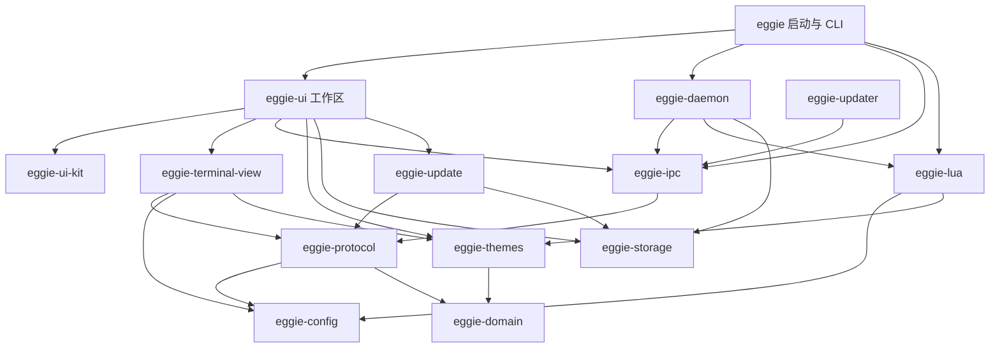

# Eggie 的 crate 与模块边界

## 设计依据

对照本地 Zed 的 `crates/ui`、`crates/workspace`、`crates/terminal`、`crates/terminal_view` 和 `crates/theme`：

- 通用控件组成一个 UI 库，内部按组件分模块。
- 工作区负责项目、标签、面板、导航和跨组件事件。
- 终端视图是完整的渲染与输入职责，适合独立 crate。
- 侧栏、标签栏、设置页面目前只有工作区使用，先作为模块组织。

借鉴职责划分，没有复制 Zed 的实现。Zed 的终端模型也使用 GPUI；Eggie 的 daemon 在独立进程运行，因此依赖图按自己的进程边界设计。

## 依赖图



`eggie-build-info` 向启动器和 GUI 提供同一份版本、构建日期和构建标识；它没有运行时依赖。图中省略了 GPUI、Alacritty 和常用第三方库。

## 各 crate 的职责

| crate | 负责 | 约束 |
| --- | --- | --- |
| `eggie` | 参数分派、CLI、进程入口、组装 GUI 与 daemon | 应用组装处，可以依赖完整功能 |
| `eggie-ui` | 工作区、项目导航、侧栏、标签、设置、GUI 状态适配 | 不导入 daemon 实现、Lua VM 或终端内核 |
| `eggie-ui-kit` | 通用图标、连续圆角、独立弹出窗口、系统外观判断 | 不知道项目、会话或终端协议 |
| `eggie-terminal-view` | 终端绘制、字形缓存、CoreText 光栅化、Metal、IME 接口、延迟统计 | 只消费快照和输入接口，不持有客户端或工作区 |
| `eggie-daemon` | PTY、Alacritty、会话、OSC、服务端请求、配置服务 | 不依赖 GPUI 或 GUI 控件 |
| `eggie-ipc` | 客户端、输入队列、socket 生命周期、帧编码、共享内存传输 | 不导入终端内核或 daemon 实现 |
| `eggie-protocol` | 可序列化的请求、响应、事件、会话与终端快照契约 | 不导入 Lua VM、GPUI 或终端内核 |
| `eggie-domain` | 项目、布局、profile、标识、终端颜色与 cell 属性 | 纯数据和规则 |
| `eggie-config` | 共享配置契约、字体参数与解析 | 纯数据，不执行 Lua，也不加载 GUI 资源 |
| `eggie-lua` | Lua 注册 API、配置求值、校验、事件回调 | 返回配置契约，不管理 UI |
| `eggie-themes` | 内置主题资源、目录、解析、语义 UI 配色、配色审计 | 无 GPUI 或 Lua 依赖 |
| `eggie-storage` | 配置路径、状态目录、JSON 原子写入、损坏文件隔离 | 不依赖 updater 或 GUI |
| `eggie-update` | 更新元数据、检查、下载和更新状态 | 不间接引入 PTY、Lua 或 GUI |
| `eggie-updater` | 独立更新进程与 daemon 停止协调 | 使用 IPC，不链接 daemon 内核 |
| `eggie-build-info` | 版本、日期、开发内容哈希 | 一份构建身份供各入口使用 |

版本只在根 `Cargo.toml` 的 `[workspace.package]` 定义。资源随其使用者归属：主题在 `eggie-themes`，控件字体在 `eggie-ui-kit`，终端 fallback 字体在 `eggie-terminal-view`，CLI 的颜色名表在 `eggie`。许可证一并移动。

## 工作区与页面组织

`WindowManager` 是应用级 GPUI Entity，管理全部窗口的位置、全局终端目录、后台标签页、撤销与持久化。每个 `EggieApp` 是窗口的投影，负责输入、绘制与窗口内交互。内部状态明确分组：

- `WorkspaceState` 持有项目镜像、每个项目的布局、活跃项目与收起状态；活跃布局访问器由它维护。
- `SessionFeedState` 持有会话、快照、检查结果、订阅集合和状态更新缓存。
- `SidebarState` 持有拖拽、独立弹窗、预览、跑马灯和图标过渡状态。

`app/` 内分别组织启动、会话订阅、项目操作、侧栏、标签、布局、终端输入、搜索、命令面板、悬停交互和右侧面板。`app/windows/` 按窗口生命周期、导航、转移和选择器组织。终端转移是纯展示事务，失败保留源位置；窗口发布携带版本号，过期的本地投影不能重新认领已移走的终端。OSC 和进度在 `workspace/session_streams.rs` 每个终端只订阅一次，阻塞 IPC 使用独立 IO 线程；快照按窗口可见内容订阅。

`actions.rs` 负责应用命令和原生菜单。设置窗口通过页面模块组织 `profiles`、`gallery`、`selector`、`keybindings`、`about`、`controls` 和 `editing`。`settings/` 分开 GUI 选项模型、外观叠加解析和持久化 store。GUI 表单校验与 GPUI 快捷键解析继续归属 GUI；字体解析及其他共享契约归属 `eggie-config`。

## 终端视图边界

UI 的 `div` 统一来自 `eggie-ui-kit::continuous_corners`，普通 radius 辅助方法在背景、交互状态、描边和阴影上应用 Apple 风格的连续 R 角。底层 GPUI 提供可选的四阶超椭圆轮廓，将名义半径换算成曲线延展范围，保留原圆弧在对角线方向的切角大小；圆形与满半径胶囊保留圆弧。SVG 图标卡片使用三次曲线近似。主题卡片的显式曲线延展范围保持原值，也使用同一 GPU 绘制能力。终端面板通过 `mask_corners` 在子内容绘制后、描边前覆盖轮廓以外的像素，支持零 padding 的 Metal 内容，遮罩只绘制边缘条带。

`TerminalInputTarget` 定义读取 composition、提交文字、更新 composition 和取消 composition 四个操作。工作区实现接口，渲染器只持有一个弱 Entity 适配器；窗口销毁后更新自然失效，不形成引用环。

cell 属性由 `eggie-domain::TerminalCellFlags` 定义。daemon 在编译期检查 Alacritty 的各个属性位与稳定协议一致，随后直接发送原有 `u16`，无需每个 cell 执行映射循环。终端视图不再依赖 Alacritty，cell 的序列化形式保持不变。窗口重构删除 daemon 中的窗口归属、认领与分离接口；文字共享行将应用协议升级为 v4。

Metal 内部按字形 atlas/cache、后端与图片上传、字体 shaping/rasterizer 分模块，shader 是独立 `.metal` 资源。共享内存的句柄与帧解析属于 IPC，共享内存映射和回收也属于 IPC，GPU 消费属于视图。协议只定义不可变行存储和借用 cell 视图；`eggie-ipc` 实现映射行租约，视图无需依赖 IPC 或 daemon。传输与生命周期见 [terminal-transport.md](terminal-transport.md)。

## daemon 模块

入口只组织模块及共享内核类型。`server` 处理请求，`session` 管理 PTY 和会话生命周期，`snapshot` 投影快照，`search` 和 `urls` 负责查询；OSC 分为事件流、进度、shell integration、通知、剪贴板与文件传输。配置、事件总线、preferences、进程检查和远程启动也各自有模块。

内部模块之间的可见性限制在 daemon 内，客户端只通过 `eggie-ipc` 使用协议。

## 验证和持续约束

```sh
python3 scripts/check-architecture.py
cargo check --workspace
cargo test --workspace
scripts/theme-palette-audit.sh /tmp/eggie-theme-audit.html
cargo build -p eggie
```

架构检查读取 Cargo metadata，检查生产依赖和工作区内的可达依赖，不需要构建 GPUI。它约束底层 crate 的依赖集合，并阻止协议、IPC、更新器重新间接引入 Lua 或终端内核。发布流程执行同一检查。

原有的协议、PTY、OSC、配置、图形、项目排序和 UI 状态测试继续运行；纯字体解析、主题审计、颜色解析和客户端队列测试随实现移动到其归属 crate。

新建 crate 的判断标准是独立职责、清晰依赖和可独立验证的 API。当前无需为每个设置页面、侧栏控件或标签栏单独建 crate；多个应用级消费者或独立生命周期出现时，再提升完整模块。
